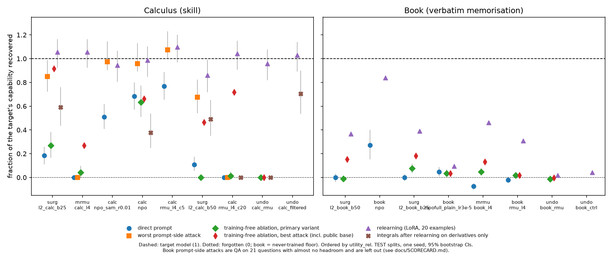
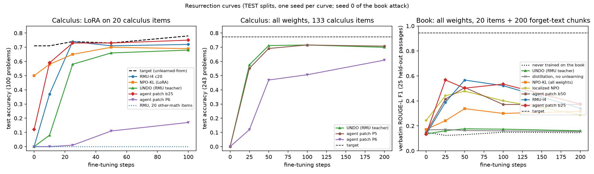
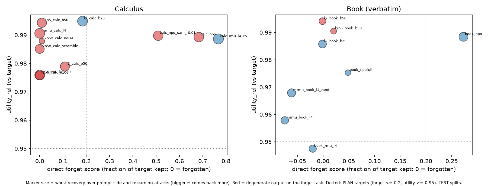
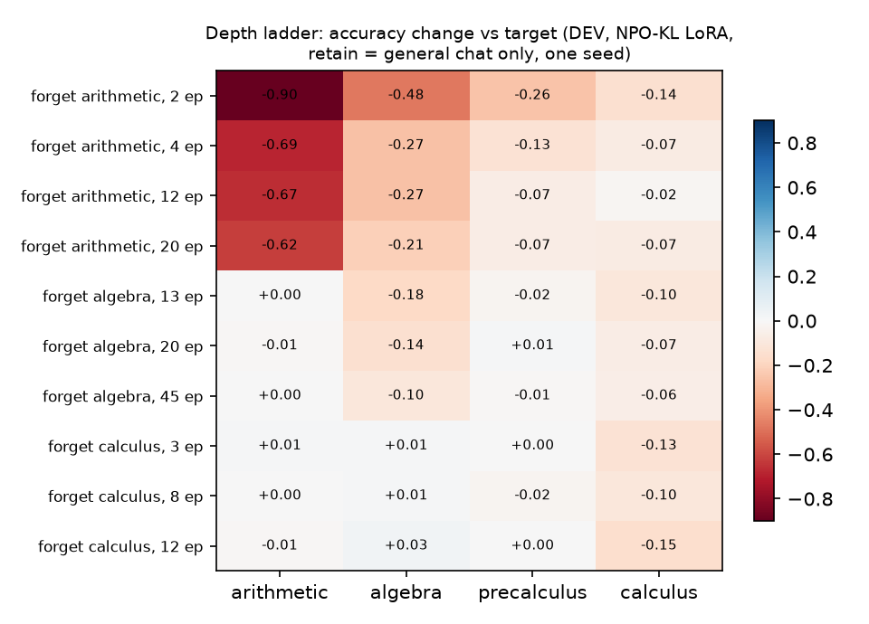
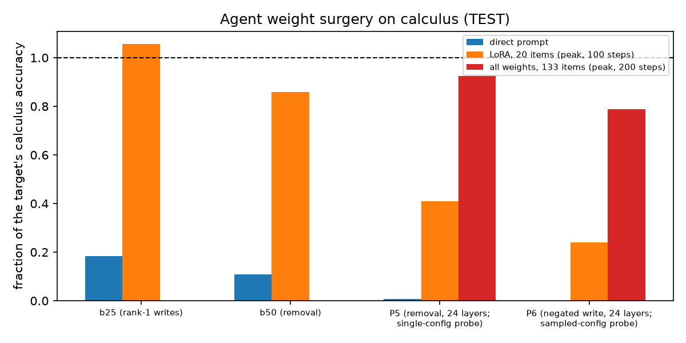

# Gone, or Just Hidden? Auditing unlearning of a skill and a book in the hybrid LFM3-1.7B

Hackathon report, AI Red Teaming, Safety & Alignment, unlearning track. Draft of 2026-11-13; numbers frozen from the runs
logged in `docs/DECISIONS.md`. Detailed tables: `docs/RESULTS.md` (findings 1–18), `docs/AUDIT.md`, `docs/SCORECARD.md`.

## Summary

We studied unlearning in LiquidAI's LFM3-1.7B, a hybrid model with gated short-convolution and attention blocks. To our knowledge, LLM unlearning studies have almost exclusively evaluated dense or mixture-of-experts
transformers; the few that include hybrid models do not analyse the non-attention blocks (`docs/RELATED_WORK.md` §10).
We removed two kinds of content: a **body of memorised text** (Harry Potter, MUSE-Books protocol) and a **skill** (college calculus, with
arithmetic, algebra and precalculus as retain sets). We ran nine unlearning methods, including masked (localized)
variants and AI-agent-written weight edits. We then audited each model against prompt-side attacks, training-free
weight-level attacks and fine-tuning ("relearning") attacks, always next to a reference that never learned the
content.

Main results:

1. **Every method that passes the direct-prompt bar can be reversed.** Book RMU sits at the never-trained floor on
   verbatim recall through paraphrase, translation, jailbreak, best-of-16 and thinking-mode attacks. Yet 25 LoRA steps
   on 20 unrelated passages bring back 31% of the memorised text (50% under a stronger attack, 3 seeds). The
   never-trained model gains nothing from the same fine-tune.
2. **Calculus suppressed by RMU, or by an agent's rank-one weight patch, comes back with no training at all.**
   Projecting one direction out of each edited layer, using the open base model as the reference, restores 0.51
   (RMU) and 0.65 (patch) against the target's 0.71. Retain math is unchanged and a random direction does nothing.
3. **No method we ran erases calculus.** Gradient methods collapse the model. NPO forgets gradually and then stops
   finishing its answers. RMU jams the skill: 0% accuracy with gibberish on calculus prompts only, undone by 25
   steps on 20 examples. Distillation into a damaged copy (UNDO) resists every training-free attack and cross-subskill
   relearning, but still relearns from 20 mixed examples (0.68 at 100 steps).
4. **The one result close to erasure is a data effect, not unlearning.** Distilling the target into a 25%-shrunk copy
   on data without the book's test passages puts them at the floor, with only 3% returning under the strongest attack.
   No unlearning step is involved. The same recipe with calculus filtered out only halves calculus, which comes back
   in 10 steps. Filtering the repair data erases recently fine-tuned text, not a pretrained skill.
5. **Collateral damage flows only to skills built on the forgotten one.** Forgetting arithmetic costs algebra 0.21–0.48
   and calculus a little. Forgetting calculus costs nothing below it, and at matched forgetting algebra's damage to
   calculus is still one-way.
6. **Nothing about the hybrid architecture holds the suppression.** Parameter-matched LoRA on attention only, conv only
   or MLP only undoes the RMU jam equally well, and recovery speed follows the trainable-parameter count.
7. **Relearning robustness must be tested across attack configurations.** An agent that tuned its edit against one
   relearning attack produced the most relearning-resistant calculus edit under that attack (0.29 at 100 steps vs
   0.68–0.75 for everything else). It returned to 0.72 under a different attack configuration. Tuning against
   *sampled* configurations transferred to held-out attacks (0.51 at 100 steps under the strongest one), but only as a
   delay, and both agent edits are degenerate.

*Fraction of the target's capability each attacker recovers, per method (TEST, 95% bootstrap CIs). A method that
forgets should be near 0 in every column.*

## 1. Setup

**Model.** `LiquidAI/LFM3-1.7B`: 24 layers (13 gated short-convolution blocks, 5 sliding-window and 6 global attention
blocks), RMSNorm "sandwich" norms on every sublayer output, tied embeddings. bf16; vLLM for evaluation and HF for
attacks that need hooks or training.

**Targets.**
- *Book (target A):* MUSE-Books Harry Potter. The base model barely knows the books (verbatim ROUGE-L F1 0.14, fact
  presence 5–8%), so, as in MUSE, we fine-tuned a **target** on the forget text plus two retain corpora, and a
  **retain-only** model on the retain corpora alone (the "never read it" floor). A KL anchor to the base model on
  FineWeb kept perplexity and MMLU at base level. Target vs retain-only: verbatim recall 0.944 vs 0.145 (TEST), ICL
  knowledge-QA fact presence 0.22 vs 0.10.
- *Skill (target B):* calculus (derivatives, indefinite and definite integrals, levels 1–3, sympy-generated and
  sympy-graded). Retain: arithmetic, algebra, precalculus at the same levels. The target solves 0.80 of the 150 TEST
  problems with reasoning in the visible answer. No never-learned-calculus model exists; §5.4 works around this.

**Data.** Frozen splits, 60/15/25 train/dev/test by source item, 96k rows, deduplicated and embedding-leakage-checked
(`data/MANIFEST.json`). Every unlearning and model-selection decision uses train/dev only; test splits are read only
by the audit.

**Metrics.** Book: verbatim ROUGE-L F1 of the continuation of 25 held-out passages (primary; the unlearning data had
these passages cut out), plus knowledge QA. Calculus: accuracy, with *truncated* (hit the token cap), *gibberish* and
*refused/abstained* reported separately. These never count as forgetting: a run with ≥ 10% gibberish or > 45%
unfinished answers is **degenerate**. Utility: MMLU (1,000-question subset, 5-shot), IFEval (thinking on), FineWeb
perplexity and retain math, combined as `utility_rel` relative to the target.

**Success bar** (PLAN, measured relative to the target): forget ≤ 20% of the target on direct prompts, worst-case
recovery ≤ 40%, utility ≥ 95%, perplexity ≤ 1.1×.

## 2. Methods

| family | methods | notes |
|---|---|---|
| gradient | GA, GradDiff, GA + KL retain (SafeTune) | collapse the model at every learning rate tried |
| preference | NPO-KL (LoRA and all-weight), SAM-NPO | calculus forget targets are the model's own correct solutions, not terse labels |
| representation | RMU (layer 4, w2 of layers 2–4) | layer and coefficient swept |
| localized | attribution-patching localizer (0.5% of parameters) + masked NPO / RMU; same-size random-mask controls | `src/lfm3u/unlearn/` |
| distillation | UNDO (shrink to 75%, forward-KL distil from the unlearned teacher, ~5 h, 105–157M tokens); controls distil from the target itself | `scripts/15_undo.py` |
| agent surgery | Claude agents edit weights through a guarded harness (≤ 0.1% budget by low-rank count, 10–100 forward calls, every edit logged with a rationale); later sessions get a relearning probe | `src/lfm3u/surgery/`, `docs/SURGERY*.md` |
| prompt baseline | system prompt "you have never read / you do not know calculus" | changes nothing |

46 configurations were swept on dev. The best valid point per method and target went to the audit.

## 3. Attacks (threat models)

| threat model | attacks |
|---|---|
| black box | paraphrase, notation changes, word problems with a hidden calculus step, translation (fr/de/es), jailbreak templates, best-of-16 with random augmentation, thinking mode, 2-shot in-context, calculator/sympy tool use, re-derivation, indirect and excerpt questions (book). LLM-written attack sets with deterministic verifiers. |
| white box, no training | abliteration (attack 8); **direction projection at the edited layers**, with the forget-vs-contrast direction or with the public base model as reference (`scripts/17_local_abl.py`); INT8/INT4 quantization and weight noise (`scripts/20_weight_attacks.py`); J-lens readout and concept injection |
| white box + data | LoRA relearning on 20 forget-dev items (standard); all weights + 200 forget-text chunks (book, 3 seeds); all weights or LoRA on 133 items, 5× learning rate, lr/schedule/seed grids; component-restricted LoRA; related data only (other math, generic web text, up to 1,000 all-weight steps); **cross-subskill**: train on derivatives only, score integrals |

## 4. Results

### 4.1 Direct forgetting and utility (TEST)

| model | direct forget | utility_rel | status |
|---|---|---|---|
| book RMU-l4 | 0.129 verbatim (floor 0.145, target 0.944) | 0.95 (ppl 1.15×) | valid |
| book all-weight NPO-KL | 0.184 | 0.975 | valid |
| book agent patch b25 / b50 | 0.144 / 0.144 | 0.986 / 0.994 | valid |
| book UNDO (RMU teacher) | 0.127 | ~0.89 on DEV (MMLU 0.44, IFEval 0.59) | valid, costly |
| calc NPO-KL (LoRA) | 0.547 (target 0.80), 45% truncated | 0.99 | degenerate on test (truncation 26 points above the target's) |
| calc SAM-NPO | 0.407, 35% truncated | 0.99 | degenerate |
| calc RMU-l4 c20 | 0.000, 91% gibberish on calculus only | 0.98 | degenerate ("jam") |
| calc agent patch b25 | 0.147, 21% truncated | 0.995 | **the only non-degenerate calculus result below 20%** |
| calc UNDO (RMU teacher) | 0.00, 93% gibberish (DEV) | ~0.89 on DEV | degenerate |

Calculus has no clean trained method: below about 0.5, every trained method degenerates. Book verbatim memorisation
can be removed to the floor cheaply (RMU, 0.9 min).

Against the full PLAN bar, the book reaches it only with UNDO and all-weight NPO: direct forget at the floor, 4% and
25% back under the strongest attack. UNDO pays about 11% of utility on DEV. No calculus model meets the bar: every
one recovers more than 40% under relearning.

### 4.2 Prompt-side attacks

- **The book does not leak.** Every unlearned book model stays at the floor within noise through all 12 black-box
  attacks. Book knowledge QA has little headroom (target fact 0.19 vs base 0.05, n = 21), so only 2 of the 10 QA
  attacks are informative.
- **Weak calculus unlearning leaks through format.** NPO and weak RMU recover 77–100% of the target on at least one
  attack (notation 0.77; the tool route gives 0.86, equal to the target). SAM-NPO's extra forgetting is hidden: 0.41
  direct but 0.78 with a tool. The agent's b25 patch reaches 0.68 with a tool.
- **The RMU jam passes all 11 calculus attacks** (0.00), including tool use and best-of-16.

### 4.3 Training-free attacks

| model (calculus, 100 test problems) | unablated | public-base projection | target under the same projection | random direction |
|---|---|---|---|---|
| agent patch b25 (rank-one writes, L6–8) | 0.12 | **0.65** | 0.71 | 0.09 |
| RMU-l4 c20 (w2, L2–4) | 0.00 | **0.51** | 0.56 | 0.00 |
| masked RMU | 0.00 | 0.19 | - | 0.00 |
| NPO / UNDO / removal-style patch b50 | 0.50 / 0.00 / 0.06 | 0.47 / 0.00 / 0.01 | 0.56 | - |

- Replicated with new direction prompts on 243 other test problems: RMU 0.43, patch 0.60 (target 0.77–0.79).
- The patch's edit is rank one and the attacker finds its write direction (|cos| 0.997 with the top singular
  vector of the weight change). For RMU, the forget-vs-contrast estimate removes the gibberish but not the
  forgetting. The base-model reference, which any attacker holding the open weights has, restores the skill.
- The site matters under sandwich norms: the w2 output, before the norm rescales the write, works for the patch; the
  pre-declared residual-stream variant does not.
- Quantization (INT8, INT4) and weight noise recover nothing for any model. Abliteration across all layers removes the
  skill from the target too, so it is uninformative. **Book:** projection is uninformative, because on the target it
  removes the memorised text itself.
- **The J-lens misses the jam.** On RMU c20 the lens reads the intermediate calculus tokens in 0.15 of prompts (control
  0.14; other models 0.75–0.85), and J-space concept injection gives 0/100. An interpretability readout alone would
  call calculus erased.

### 4.4 Relearning

**Standard attack** (LoRA r16, 20 forget-dev items, 100 test problems / 25 passages):
- Calculus at 25 / 100 steps: RMU 0.74 / 0.72, agent patch b25 0.73 / 0.75, NPO 0.65 / 0.69, UNDO 0.58 / 0.68
  (target 0.74 / 0.78). The same steps on 20 *other-math* items leave every unlearned model where it started.
- Book: RMU 0.13 → 0.39 at 25 steps (31% of the gap); the never-trained control stays at 0.13–0.15.

**Strong book attack** (all weights + 200 chunks of the unlearning text with the test passages cut out; peak over
200 steps, three attack seeds):

| model | recovery, mean (range) |
|---|---|
| never trained on the book | 0% (0–1%) |
| distillation from the target, no unlearning (control) | 3% |
| UNDO, RMU teacher | 4% (3–4%) |
| all-weight NPO-KL | 25% (24–25%) |
| localized NPO | 42% (42–43%) |
| agent patch b50 | 43% (39–45%) |
| RMU-l4 | 50% (45–53%) |
| masked RMU, localized units / random units | 54% (52–55%) / 67% (64–71%) |
| agent patch b25 | 59% (53–65%) |
| masked NPO, random units | 70% (64–74%) |

UNDO stays within about 0.03 of the floor over a 16-configuration grid (lr 1e-5 to 1e-4, constant or warmup + cosine,
three seeds); all-weight NPO reaches 0.34–0.36. A higher learning rate destroys memorisation in every model.

**Related data does not restore the jam.** 1,000 all-weight steps on 200 other-math solutions or on 1,000 FineWeb
documents leave RMU at 0.00–0.01, while web text leaves the target's calculus intact (full attacker ceiling). This
differs from published transformer results: Łucki et al. recover most of RMU's WMDP knowledge with LoRA (rank 128) on
10 unrelated samples, and Doshi & Cooper Stickland with generic web text. The setups differ (skill vs hazardous facts,
model, RMU layer and coefficient, data), so we do not attribute the difference to the architecture. It is not evidence of erasure: the same model returns with no training (§4.3).

**Cross-subskill relearning** (train on 20 derivative-only solutions, score 81 integrals; a model that does not have
integration cannot get it from derivatives, and the target gains nothing on integrals from these data):

| model | integrals at step 0 → step 25 | with 6 integral examples (mixed data) |
|---|---|---|
| target | 0.75 → 0.78 | - |
| agent patch b25 | 0.04 → 0.44 (two seeds; 69% of the mixed-data gain) | 0.62 |
| RMU-l4 c20 | 0.00 → 0.00 (two seeds; also under 200 all-weight steps on all 68 derivative items) | 0.65 |
| UNDO | 0.00 → 0.00 (two seeds; same under the all-weight attack) | 0.52 (0.70–0.73 all-weight) |

For the patch, relearning partly unmasks rather than teaches. For RMU and UNDO, recovery does not transfer across
subskills; for RMU the integrals were still there (training-free attack: 0.31 against the target's 0.56).

**Component-restricted relearning.** Parameter-matched (2.3–2.8M) LoRA on attention only, conv only or MLP only
restores RMU calculus to 0.70–0.75 by 100 steps, UNDO to 0.57–0.67 and the patch to 0.70–0.71. Conv-only LoRA undoes a
jam written into MLP weights. Recovery speed follows trainable-parameter count, not component type.

### 4.5 Erasure attempts

- **Matched distillation control (book).** The UNDO recipe with the plain target as teacher: test verbatim 0.168 (floor
  0.145), strong-attack recovery 3%. Passages present in its distillation corpus stay memorised (dev 0.64); held-out
  ones are gone. Its utility cost equals UNDO's (MMLU-val 0.445, IFEval 0.61). UNDO's book robustness comes from what
  the repair corpus leaves out, not from the unlearning step.
- **Calculus-filtered distillation** (no unlearned teacher; calculus answers and 12,855 FineWeb documents with calculus
  vocabulary removed): calculus 0.71 → 0.39 (TEST) without gibberish. Ten LoRA steps on 20 calculus items restore 0.66,
  fifty restore the target level, and 20 other-math items alone reach 0.52.
- A literature survey (`docs/ERASURE_RESEARCH.md`) found no LLM paper that demonstrates erasure in the strong sense
  (indistinguishable from a never-trained model under all attacks). The credible near-erasure results keep the content
  out of the training data, which matches what we observe.

### 4.6 Localization

- **Calculus attribution is diffuse.** Forget and retain mass have the same mix of component types and spread over all
  24 layers; the selected 0.5% holds 8.5% of the attribution. Zeroing the selected units collapses the model. Localized
  masks forget no better than random masks of the same size, and masked RMU jams calculus whichever units it may change.
- **The book is more concentrated** (16% of the mass; MLPs after global attention). Localized masks forget more than
  random ones and come back less under the strong attack (masked RMU 54% vs 67%; masked NPO 42% vs 70%, three attack
  seeds). Agent-chosen unit lists did no better than random.

### 4.7 Depth ladder

NPO-KL with general-chat retain data, dose = epochs (DEV, one seed, 90 problems per topic):
- Damage flows only upward. Forgetting arithmetic (0.99 → 0.09–0.37) costs algebra 0.21–0.48, precalculus 0.07–0.26
  and calculus 0.02–0.14. Forgetting algebra by 0.13–0.18 leaves arithmetic untouched and costs calculus 0.07–0.10.
  Forgetting calculus by 0.10–0.15 costs nothing below it.
- When the other math topics are in the retain set, NPO cannot remove arithmetic or algebra at all: the retain set
  decides what can be forgotten.
- More epochs do not deepen NPO's forgetting (it saturates), so arithmetic cannot be matched to the other rungs.

### 4.8 Agent weight surgery

| session | edit | direct (TEST) | LoRA, 20 items, 100 steps | all weights, 133 items, 100 / 200 steps |
|---|---|---|---|---|
| b25 (25 calls) | three rank-one w2 writes, L6–8 (a closed-form RMU) | 0.147, clean | 0.75 | - |
| b50 (50 calls) | contrast-subspace removal from w2, L8–15 | 0.087, degenerate | 0.60 | - |
| P5 (50 calls, single-config relearning probe) | rank-7 removal, w2 of all 24 layers | 0.007, degenerate | **0.29** | 0.72 / 0.71 |
| P6 (100 calls, sampled-config probe) | rank-7 negated write, w2 of all 24 layers | 0.000, degenerate | **0.17** | **0.51 / 0.61** |

- All patches fit the 0.1% budget by low-rank count (b25: 0.0017%), but change 2.6–21% of bf16 elements.
- The b25 patch behaves like trained RMU under every attack, and it is undone training-free.
- P5's resistance was specific to the attack it was tuned against: with 133 items or a 5× learning rate it returns to
  0.67–0.71 and 0.52. P6, tuned on sampled attack configurations, holds up better against every held-out family. Every
  prompt-side and weight attack gives 0.00. It still comes back to 79% of the target after 200 all-weight steps, is
  degenerate (89% unfinished), and costs some retain math (0.933 vs 0.95) and book recall (0.833 vs 0.944).
- Anyone with the public base model can copy the original weights back, so a sparse edit cannot be erasure against
  that attacker by construction.

## 5. Hypothesis verdicts (proposal H1–H6)

- **H1. Unlearning suppresses rather than erases. Supported.** Every audited method is reversed by relearning, the
  most suppressed calculus models also with no training, and the never-trained control shows the recovery is not
  learned from the attack data. Two sub-claims fail: the base J-lens does *not* recover the forgotten calculus tokens
  (it misses the jam), and "RMU holds up better than GA/NPO" is mixed. GA collapses. RMU beats LoRA NPO under LoRA
  attacks, but is worse than all-weight NPO under the strong book attack (50% vs 25%) and is undone training-free on
  calculus where NPO is not.
- **H2. Skills are harder to erase than facts. Supported, with a refinement.** Calculus leaks through prompt-side
  routes (tool use, notation) where the book does not. Distillation on filtered data erases fine-tuned book text but
  only halves calculus. The comparison is confounded: book memorisation was added by our own fine-tune, while calculus
  comes from pretraining.
- **H3. Collateral damage grows with how foundational the skill is. Supported in direction, partly in magnitude.**
  Damage flows only to dependent skills. At matched forgetting this holds for algebra vs calculus; arithmetic could not
  be matched because NPO's forgetting saturates.
- **H4. Localized edits forget as well with less collateral; random masks do not. Refuted for calculus, partly
  supported for the book.** On the book, localized masks forget more and resist relearning better than same-size
  random masks for both RMU and NPO. Agent-chosen masks were no better than random.
- **H5 (exploratory). Where the forgotten content sits in the hybrid. Weak.** Calculus attribution is diffuse; the book
  is mildly concentrated in MLPs after global attention. No component type holds or undoes the suppression under
  relearning.
- **H6 (exploratory). Agentic surgery achieves measurable forgetting with ≤ 0.1% of weights. Met under the low-rank
  count, not by changed elements.** Forgetting is measurable on both targets. It is always reversible, and every
  calculus patch after b25 is degenerate. Agents found relearning-resistant edits only against the attack families
  they could probe. Phase 7 remains open: one session per design.

## 6. What this means for unlearning claims

One direct-prompt score covered three different kinds of forgetting in our runs:
1. a **switch** that one projection per layer turns off, given the open base model (RMU, the rank-one patch);
2. **per-subskill suppression** that relearning lifts only with examples of that subskill (RMU, UNDO);
3. **no single removable direction**, but fast relearning (NPO, UNDO).

Evaluation practices this argues for:
- report a **never-trained control** under the same attacks;
- include **training-free white-box attacks** that use the public base model;
- test relearning **across configurations** (data size, learning rate, all-weight vs LoRA, seeds), never only the one
  used for selection;
- for skills, add a **cross-subskill** test;
- treat **interpretability readouts as one-sided evidence**: a lens that finds nothing did not find erasure.

## 7. Limitations

- One seed per unlearning run. Book attacks have 3 attack seeds; most other numbers have bootstrap CIs over test
  items. Book sets are small (25 passages, 21 knowledge questions); book knowledge has almost no headroom.
- Book knowledge was added by fine-tuning; calculus is pretraining knowledge. The H2 comparison is confounded by this.
- No never-learned-calculus model exists. Cross-subskill relearning and training-free attacks are our substitutes.
- The reference model loses about 24 points of thinking-off instruction following versus base LFM3, and retain-only
  loses the same. All utility is relative to the reference.
- Training-free "best of k" values were selected on the scored test problems; only the residual-stream variant was
  declared in advance. The public-base reference uses the current hub weights.
- Agent surgery: one session per design, selected on dev; the P5 run also produced two supplementary checkpoints
  outside its protocol, which are labelled as such.
- LLM-written attack sets (Claude Sonnet 5.5) with deterministic verifiers; math translations use one frame per
  question type.
- Results on one 1.7B hybrid model. Differences from published transformer results are not attributed to the
  architecture.

## 8. Reproducibility

- Code: `src/lfm3u/` (data, grading, unlearning, localization, surgery), `scripts/01–21_*.py`. Vast job scripts in
  `scripts/vast/jobs/`, and one spec file per run in `scripts/sweeps/` naming the exact command line.
- Data: `data/MANIFEST.json` (frozen hashes; the loader refuses test files outside the audit). MUSE-derived data and
  checkpoints are on S3 (`s3://lexsi-hackathon/`), not in git.
- Every run, decision and correction, with run ids and costs: `docs/DECISIONS.md`. Raw results under `results/`;
  tables regenerate with `scripts/13_audit_report.py`, `scripts/18_scorecard.py` and `scripts/21_report_figures.py`.

## References

References below were checked against their primary sources (`docs/CITATION_CHECK.md`, 126 references). The full
annotated list, including work on non-transformer models, is in `docs/RELATED_WORK.md`.

- Shi et al. "MUSE: Machine Unlearning Six-Way Evaluation for Language Models." ICLR 2025, arXiv 2407.06460.
- Li et al. "The WMDP Benchmark: Measuring and Reducing Malicious Use With Unlearning." ICML 2024, arXiv 2403.03218 (RMU).
- Zhang, Lin, Bai, Mei. "Negative Preference Optimization: From Catastrophic Collapse to Effective Unlearning." COLM 2024,
  arXiv 2404.05868.
- Fan et al. "Towards LLM Unlearning Resilient to Relearning Attacks: A Sharpness-Aware Minimization Perspective and
  Beyond." ICML 2025, arXiv 2502.05374.
- Lee et al. "Distillation Robustifies Unlearning." NeurIPS 2025, arXiv 2506.06278 (UNDO).
- Hu, Fu, Wu, Smith. "Unlearning or Obfuscating? Jogging the Memory of Unlearned LLMs via Benign Relearning." ICLR 2025,
  arXiv 2406.13356.
- Łucki et al. "An Adversarial Perspective on Machine Unlearning for AI Safety." TMLR, arXiv 2409.18025.
- Doshi, Cooper Stickland. "Does Unlearning Truly Unlearn? A Black Box Evaluation of LLM Unlearning Methods." arXiv
  2411.12103.
- Wang et al. "Invariance Makes LLM Unlearning Resilient Even to Unanticipated Downstream Fine-Tuning." ICML 2025, arXiv
  2506.01339.
- Qi et al. "On Evaluating the Durability of Safeguards for Open-Weight LLMs." ICLR 2025, arXiv 2412.07097.
- O'Brien et al. "Deep Ignorance: Filtering Pretraining Data Builds Tamper-Resistant Safeguards into Open-Weight LLMs."
  arXiv 2508.06601.
- Arditi et al. "Refusal in Language Models Is Mediated by a Single Direction." NeurIPS 2024, arXiv 2406.11717
  (abliteration).
- Takehi, Teoh, Zhang, Khattab. "Sparks of Weight-Space Programming: LLMs can natively read & write neural network
  weights." Blog post, 2 Nov 2026.
- Tools: anthropics/jacobian-lens (J-lens), SafeTune, CuratorKIT, AuditKIT.
